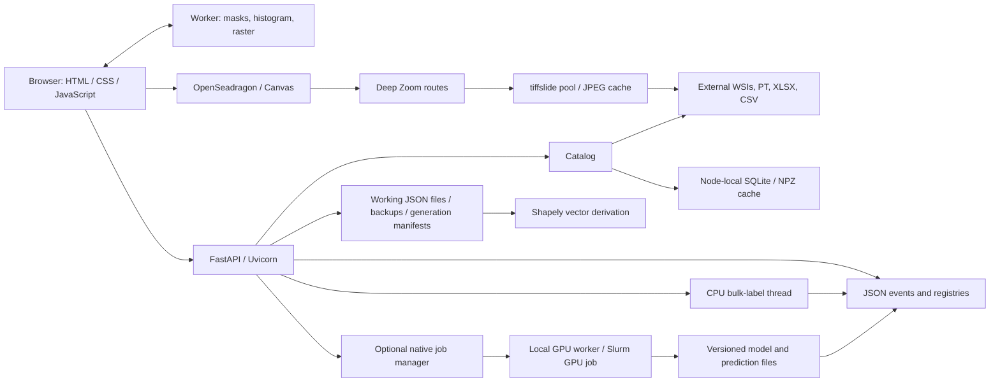

# HistoLoop architecture

## 1. System overview

A single FastAPI/Uvicorn process serves static assets and authenticated HTTP APIs. External XLSX manifests identify WSIs, PT geometry/embeddings, and prediction CSVs. The browser overlays predictions, replayed human labels, and polygon files on image tiles. Durable state consists of JSON correction events, working annotation files and registries; SQLite accelerates reads only. Optional GPU jobs execute in separate native processes or Slurm allocations.

Polygon working annotations add a second durable JSON store under a configurable
annotation root. They remain separate from the event log and training snapshots.
`annotation_files.py` preserves Histomics/GeoJSON schemas, validates geometry,
checks SHA-256 revisions, locks samples, and publishes fsynced atomic file writes
with recoverable versions. `migrate_annotations.py` resolves source cohorts against
manifest identities and uses a reviewed dry-run plan plus exclusive publication.
The registry prevents coincident basenames from merging samples across cohorts.

Shapely/GEOS computes exact `M ∩ T` and `(C \ M) ∩ T` vectors from a shared input
snapshot. `.generation.json` plus staged outputs and backups recover incomplete
two-file publication. Missing, empty, invalid, stale and current annotations have
distinct states. The browser never supplies filesystem paths for layer editing.

`annotation-manager.js` uses the existing viewer drawing surface and preferences;
file drafts cannot create tile-label events. Layer rows defer region lists until
expansion and paginate at 30 regions. Existing `panels.js` owns disclosures,
sidebar widths/visibility, drawers, and Focus viewer. The original responsive grid
and OSD resize lifecycle remain in place.

`prediction-field.js` is shared by the existing worker and fallback. It keeps a
bounded mean decision-score field over physical level-zero tile footprints and
uses an order-independent display rule: a covered cell is medulla if any tile
covering it meets the selected run threshold; otherwise it is cortex. The same
raster drives overview, zoom and raw-label overlap inspection. Heatmap scores
remain the mean SVM decision score, not calibrated probabilities. Threshold
changes reuse coverage/score fields and do not change baseline predictions or
fixed human labels. Worker generations discard stale results; one current and
one coalesced next filter keep queueing bounded. A displayed-field PNG and JSON
parameter export are separate derived artifacts, not registered inference or
training inputs. Native contour masks can be copied into editable `Tissue_qc.json`
without changing the configured source contour.

See [working annotation design](docs/annotation-workspace.md) for schemas,
atomicity/recovery contracts, overlap rules, deployment binds and raster limits.
See [workspace validation](docs/workspace-validation.md) for real measurements and
local-only screenshot status.

## 2. Architecture diagram



## 3. Frontend architecture

The interface uses HTML, CSS Grid/Flexbox, vanilla JavaScript, and vendored **OpenSeadragon 5.0.1**, with no frontend framework or build system.

| Source | Responsibility |
|---|---|
| `static/index.html`, `app.css`, `responsive.css`, `histoloop.css` | Controls, scientific workspace layout, responsive drawers, branding |
| `static/app.js` | Shared state `S`, dataset/slide selection, review tools, HTTP requests |
| `static/navigation-cache.js` | Bounded slide-view cache, ETags, cancellation, adjacent-view prefetch |
| `static/tile-engine.js`, `tile-worker.js` | Masks, histograms, spatial indexing, OffscreenCanvas overview rasters |
| `static/prediction-field.js` | Shared bounded mean-score field, medulla-priority labels, score colors and tissue masks |
| `static/annotation-manager.js` | Independent file layers, drafts, vertex editing, saves and versions |
| `static/panels.js` | Resize/collapse, mobile drawers, keyboard access |

OpenSeadragon uses hardware WebGL when available, with Canvas/HTML fallback; software WebGL is avoided. Separate Canvas 2D layers draw predictions and annotation geometry. A bounded aggregate raster supplies both overview and zoomed predictions; spatially indexed viewport candidates supply raw inspection and optional outlines. Cursor movement redraws only the drawing layer; opacity uses CSS compositing. Workers use the same math in a main-thread fallback where OffscreenCanvas is unavailable.

The queue is virtualized. Selection/filter state lives in `S` and DOM controls; preferences persist through `/api/preferences` under the reviewer name. Bootstrap initially uses the server login's preferences. Abort controllers and generation checks discard superseded responses. Incomplete/failed regions block unsafe navigation. Analysis consists of a signed score histogram; embedding projections and enrichment are absent.

## 4. Backend architecture

Entry point: `python -m SVC_GPU.human_loop.server`; tests call `create_app(Config)`. Uvicorn runs **one process**. Synchronous handlers use an AnyIO thread pool (default eight threads). CPU bulk labels run in a background thread; `Jobs` manages separate GPU workers without importing CUDA into the API process.

| API | Purpose |
|---|---|
| `GET /health` | Unauthenticated liveness |
| `GET /api/bootstrap`, `POST /api/preferences` | Registries, capabilities, preferences |
| `GET /api/slides`, `POST /api/datasets`, `/api/datasets/refresh` | Queue, register/rescan datasets |
| `GET /api/slides/{id}/view` | Consistent binary metadata and tile arrays |
| `GET /api/wsi/{id}.dzi`, `/api/wsi/{id}_files/{level}/{x}_{y}.jpg` | Deep Zoom descriptor and image tiles |
| `POST /api/slides/{id}/corrections`, `/undo`, `/review` | Edits, undo, completion |
| `GET /api/slides/{id}/history` | Bounded history with cursor pagination |
| `GET /api/slides/{id}/annotations`, `GET/PUT /annotations/{layer}` | Missing/present layer discovery, native documents, revision-checked file editing |
| `POST /api/slides/{id}/annotation-generation`, `POST /annotation-tissue-copy`, `GET/POST /annotation-versions/{layer}` | Exact derived geometry, editable tissue copies and recoverable saved versions |
| `GET /api/slides/{id}/prediction-tissue` | Selected vector tissue mask |
| `POST /api/bulk-labels/plan`, `/api/bulk-labels` | Revision-frozen bulk preview and writes |
| `GET/POST /api/jobs`, `GET /api/jobs/{id}/logs` | Optional model job lifecycle |
| `GET /api/export`, `/api/performance` | Audit ZIP and request/cache metrics |

Communication uses HTTP fetch and five-second job polling, without WebSockets. A workspace token establishes an HttpOnly, SameSite cookie; mutation requests check same-origin access. Reviewer names provide provenance rather than authorization. `Config.from_env()` and CLI arguments enable portable paths; direct `Config` callers keep legacy defaults. CPU launchers disable model submission in both API and UI. Viewing can omit original split metadata, while retraining requires it.

## 5. Database and storage

There is **no durable relational annotation database**. `Store` initializes registries automatically:

```text
state/
├── events/<slide_id>/<sequence>_<event_id>.json  # authoritative audit
├── review_index.json                          # recoverable summary
├── passes.json, preferences/, added_datasets.json
├── access_token, config.json
├── models/, prediction_index.json, prediction_models.json
├── predictions/<slide_id>/                    # NPZ runs, versions, active pointer
└── jobs/<job_id>/                             # request/status, logs, outputs, snapshot
```

Writes use a process mutex plus `flock`, temporary files, `fsync`, atomic rename, and directory `fsync`. Optimistic revisions reject stale edits. Event replay resolves labels; undo appends an event. Startup repairs derived summaries after interrupted writes. Fingerprints prevent replay against changed feature files.

SQLite's `cache_entries(key,signature,payload)` table in `<cache>/index.sqlite3` indexes rebuildable metadata. Bounded NPZ artifacts cache validated geometry/score arrays. Other LRUs bound JPEGs, predictions, response bytes, parsed JSON and WSI metadata. Source timestamp/size signatures invalidate reads. Cache files belong on node-local scratch; persistent state is mounted outside containers. Resolved feature paths are part of slide identity.

## 6. Tile server and image rendering

Tile delivery is built into FastAPI. `WsiPool` uses **tiffslide/TiffSlide**, tifffile/imagecodecs, and Pillow. A native OpenSlide library or separate tile server is not required.

Deep Zoom's maximum level is `ceil(log2(max(width,height)))`. At level `L`, the downsample is `2 ** (max_level-L)`; `(x,y)` selects a 256-pixel JPEG tile. The server reads the most suitable native pyramid level, composites transparency onto white, resizes edge tiles, and encodes quality-85 JPEG. The descriptor declares overlap zero. Overview reads exceeding 16 million native pixels are rejected when usable pyramid levels are missing.

Defaults are four pooled readers and a 96 MiB JPEG LRU. Leases and per-reader locks protect decoding; identical in-flight requests share a result. Private browser caching complements the server cache. OpenSeadragon requests visible image tiles; application prefetching retrieves adjacent **slide views**, not entire image pyramids.

Prediction coordinates are level-zero patch top-left pixels. Physical square patch width comes from PT metadata rather than encoder input resolution. OpenSeadragon image-to-screen transforms align overlays with the WSI. CSV/PT coordinate order must match. Compatible overlap subsets retain original tile IDs; region corrections select tile centers inside the polygon and selected grid.

## 7. Annotation data flow

1. Index the dataset workbook by sample name and resolved PT location.
2. Validate prediction CSVs against PT coordinates; select a saved run if requested.
3. Replay JSON events: `-1=no override`, `0=cortex`, `1=medulla`, `-2=excluded`.
4. Return a consistent binary view: four-byte little-endian JSON length, padded metadata, and five float32 columns `(x,y,score,prediction,human_label)` per tile.
5. Render worker-computed masks/rasters; draw a region in image coordinates.
6. Submit polygon, actor/pass, revision, fingerprint, grid/filter context. The backend recomputes eligible IDs and appends an event containing prior labels, scores, provenance and time.
7. Apply the response, invalidate affected caches, and revalidate on reload. Failed saves retain the region for retry; subsequent inference preserves human labels.

Bulk actions freeze target revisions and create one undoable event per slide; concurrent edits cause explicit skips. Training snapshots freeze corrections and original source identities, exclude fitted cases from heldout evaluation, and publish a new version without replacing the baseline.

## 8. Deployment architecture

- **Docker:** immutable Python base, hashed CPU dependencies, static assets, non-root user, localhost-published port; external read-only data and persistent state. Compose also uses a read-only image filesystem.
- **Apptainer/Singularity:** convert OCI to SIF or build `apptainer.def`; run as the invoking UID in a Slurm compute allocation. Data/state/cache binds reproduce the CPU deployment; browser access uses SSH tunneling.
- **Native HiPerGator:** same entry point and static assets. CPUs suffice for review; optional compatible RAPIDS/cuML/CuPy workers use session GPUs or configured Slurm GPU jobs.

Use one server per workspace. This is not a distributed queue or multi-tenant identity service. Commands and formats are in the [README](README.md); executed checks are in [docs/validation.md](docs/validation.md).
