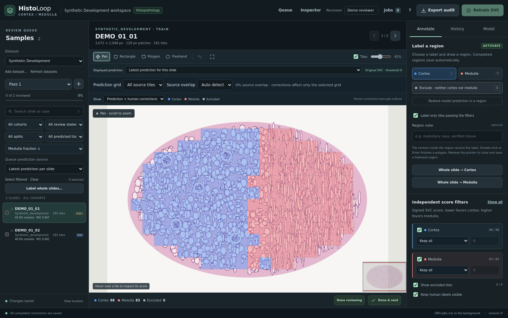
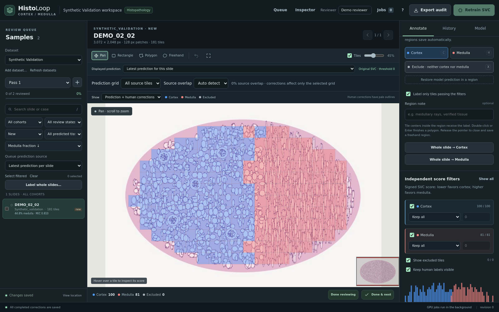
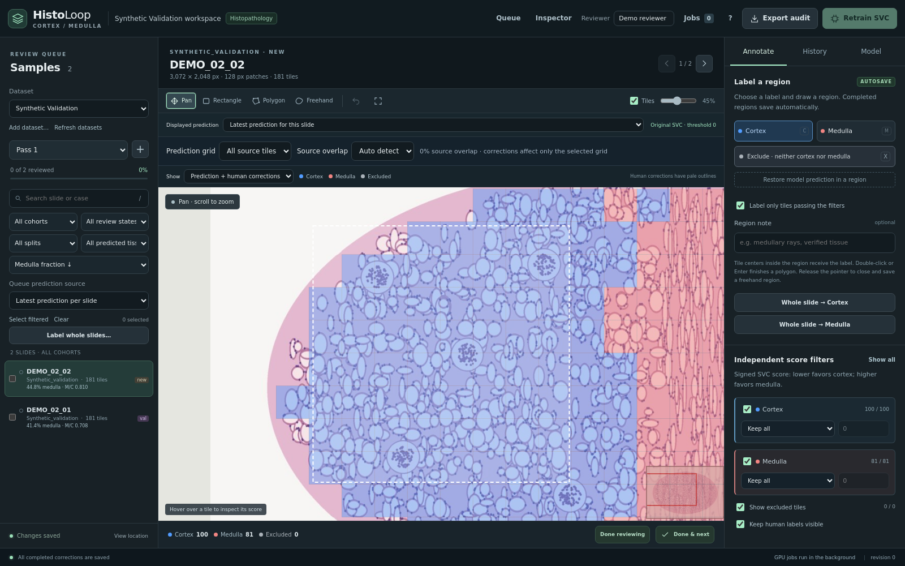
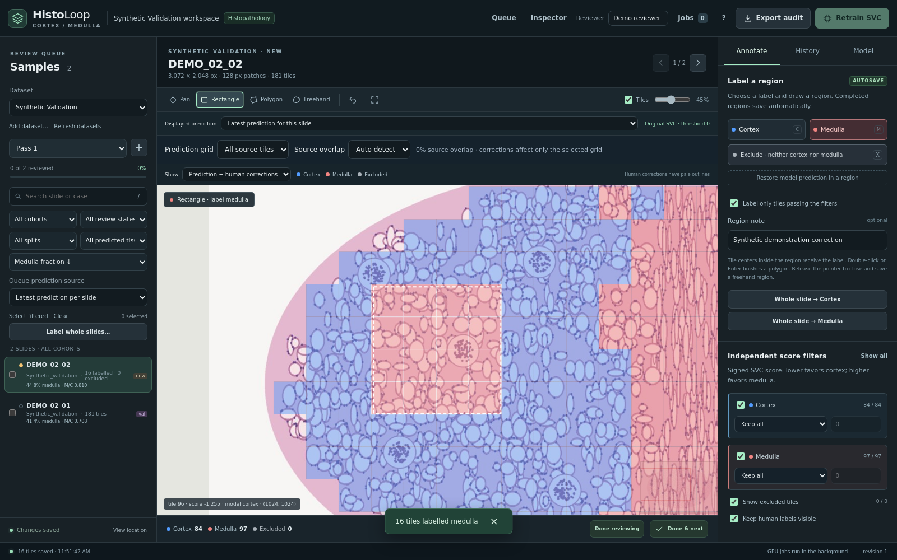

# HistoLoop

**Human-in-the-Loop Histopathology Annotation Platform**

HistoLoop is an interactive web application for visualizing whole-slide histopathology images, reviewing AI predictions, and recording human corrections. Its current workflow distinguishes kidney cortex and medulla, with an exclusion label for unsuitable tissue. Reviewers inspect prediction scores, draw regions, compare saved runs, and export an audit trail. Images and model outputs remain separate from human annotations. Prepared datasets stay on external storage; corrections persist across browser and server restarts. The architecture separates image delivery, review state, and model workers, allowing future histopathology tasks to extend the existing class definitions and model workflow.

## Key features

- Whole-slide pan/zoom with aligned prediction and human-label overlays.
- Dataset selection; cohort, split, tissue, and review-status filters; ranked sample queue.
- Rectangle, polygon, and freehand corrections; exclusion, undo, review passes, and whole-slide labels.
- Autosave, revision checks, correction history, and ZIP audit export.
- Independent class score filters, score histogram, and saved model/run comparisons.
- Optional native RAPIDS GPU prediction and retraining from frozen review snapshots.
- Persistent per-sample JSON annotation files, independent layers, vertex editing,
  revision checks, recoverable backups, and exact tissue-clipped derived classes.
- Order-independent mean/vote/Gaussian/CRF overlap display, continuous margin
  heatmaps, live preview threshold, and collapsible panels with Focus viewer.

Migration, schemas, file editing, prediction methods, container annotation binds,
and concrete limitations are documented in [Working annotations and prediction review](docs/annotation-workspace.md).
Executed tests and real-slide timings: [Workspace validation](docs/workspace-validation.md).

Containers support CPU viewing and annotation. GPU execution needs a compatible native RAPIDS environment. Embedding projections and enrichment analysis are not implemented.

## Technology stack

| Layer | Technology | Purpose |
|---|---|---|
| Frontend | HTML/CSS, vanilla JavaScript, OpenSeadragon 5.0.1 | Interface and deep zoom; no frontend build |
| Rendering | Canvas 2D, Web Workers, OffscreenCanvas | Overlays, filters, score histogram |
| Backend | Python, FastAPI 0.115.12, Uvicorn 0.34.2 | Authenticated HTTP API and job coordination |
| Storage | Immutable JSON events; SQLite read cache | Durable corrections; disposable metadata index |
| Tile service | Built-in FastAPI routes, tiffslide, Pillow | On-demand Deep Zoom JPEGs |
| Data | NumPy, pandas/openpyxl, PyTorch | Coordinates, XLSX manifests, CSV predictions, tensors |
| Deployment | Docker, Apptainer/Singularity, native Python; Slurm | Local and HiPerGator execution |

[ARCHITECTURE.md](ARCHITECTURE.md) explains the implementation.

## Screenshots

New **real-slide** captures of multi-layer annotation review, vertex editing,
aggregated heatmaps and Focus viewer were prepared locally and de-identified.
The owner requested local-only storage; public publication is blocked. These
private images are excluded from Git. The public gallery below remains synthetic.

Actual application captures at 1600 × 1000 using **synthetic tissue illustrations, random embeddings, and synthetic predictions** from [generate_demo.py](scripts/generate_demo.py). These do not represent patient tissue or model accuracy.



| Dataset and sample selection | WSI prediction overlay |
|---|---|
|  |  |



[Correction history](docs/screenshots/annotation-history.png)

[Signed score distribution](docs/screenshots/score-distribution.png)

## Repository structure

```text
SVC_GPU/
├── data.py, manifest.py, inference.py, gpu_model.py  # existing model pipeline
├── create_test_manifest.py                        # match embeddings to WSIs
├── .dockerignore, .gitignore
└── human_loop/                                   # HistoLoop; internal name retained
    ├── README.md, ARCHITECTURE.md
    ├── server.py, config.py                       # API and settings
    ├── catalog.py, wsi.py, cache.py                # inputs, tiles, caches
    ├── storage.py, annotations.py, snapshots.py    # events and exports
    ├── jobs.py, worker.py, bulk.py                 # background processing
    ├── static/                                    # browser client + vendored viewer
    ├── Dockerfile, compose.yaml, apptainer.def
    ├── .env.example, datasets.example.json
    ├── requirements.lock, requirements-portable.txt
    ├── scripts/                                   # setup, launch, demo, screenshots
    ├── docs/screenshots/, docs/validation.md
    ├── tests/                                     # synthetic regression tests
    └── state/                                     # generated; persistent; ignored by Git
```

## Required data

| Data | Format | Required? | Description | How to generate |
|---|---|---|---|---|
| WSI | TIFF-based WSI, e.g. `.svs`, pyramidal `.tiff` | For image viewing | Must be readable by tiffslide; large images need usable pyramid levels | Scanner export or compatible TIFF conversion |
| Sample manifest | `.xlsx` | Yes | `sample_name,feature_path,wsi_path` (or `folder_path`); optional `case_id` | `create_test_manifest.py` or a workbook with these columns |
| Geometry / embeddings | `.pt` dictionary | Yes | Integer `coordinates` or `coords` `[N,2]`; `tile_size` or `metadata.read_plan.patch_size_level0`; `features` `[N,D]` for model jobs | Existing encoder pipeline/checkpoint; synthetic demo generator |
| Predictions | `outputs/predictions/<sample_stem>.csv` | For prediction review | `x,y,decision_score,predicted_label_encoded`; finite scores; `0=cortex`, `1=medulla` | Existing GPU inference or compatible external exporter |
| Prediction summary | `outputs/inference_summary.json` | Recommended | `threshold`; `samples` entries containing `sample,tiles,cortical,medullary`; supplies queue statistics | Inference / demo generator |
| Dataset registry | JSON list | Required by launch scripts | Each entry: `id,name,manifest,predictions` | Edit [datasets.example.json](datasets.example.json) |
| Original split workbook | `.xlsx` | Optional for viewing; required for training | `sample_name,split,case_id`; feature locations for training; `train,val,test` splits | Established case-aware research split |
| Original labels / model | Paired `.pt/.csv`; RAPIDS `.pkl` + metadata | Only for GPU jobs | Original labels use `1=cortex`, `2=medulla`; compatible encoder/model dimensions | Existing training pipeline and checkpoint |
| Tile corrections | JSON events | Generated | Writable state directory; no database initialization required | Review tools |
| Polygon annotations | Histomics/GeoJSON JSON | Optional | Separate writable annotation root; migrate originals or explicitly create/import | Annotation manager |
| Masks / GeoJSON | PNG, GeoJSON | No | Optional model outputs; not viewer inputs | Existing inference/export utilities |

Coordinates are **level-zero top-left pixels**. Patches must be square, unique, and nonnegative; CSV coordinates/order must exactly match the PT file. Use trusted PT/model files because PyTorch/pickle payloads are loaded. Missing predictions appear in the queue but need prepared outputs before overlay review.

The cohort filter derives names from `KPMP_<cohort>` in the WSI path, otherwise `Other`. Split filtering uses the original split workbook, not the inference manifest's `split` column; unlisted samples use `new`.

## Data preparation

```text
prepared-data/
├── datasets.json
├── case_split.xlsx                  # optional for CPU review
└── kidney/
    ├── manifest.xlsx
    ├── slides/<sample>.svs
    ├── features/<sample>.pt
    └── outputs/
        ├── inference_summary.json
        └── predictions/<sample>.csv
```

Registry paths resolve relative to `datasets.json`. **Workbook paths must be absolute and visible inside the runtime**, e.g. `/data/kidney/slides/sample.svs` and `/data/kidney/features/sample.pt` in containers. Keep feature locations stable: slide IDs and correction fingerprints include those paths. Existing native paths can be preserved using additional binds to the same locations; relocating inputs requires an annotation migration.

Example `datasets.json`:

```json
[{"id":"kidney","name":"Kidney review","manifest":"kidney/manifest.xlsx","predictions":"kidney/outputs"}]
```

From the parent of `SVC_GPU`, match prepared embeddings to WSIs:

```bash
python -m SVC_GPU.create_test_manifest --feature-root /path/to/embeddings \
  --slide-root /path/to/slides --output /path/to/manifest.xlsx
```

This creates an all-test **inference** workbook, not a case-aware training split. Repeat `--slide-root` for additional directories. Generate with the final runtime paths visible, or update the workbook's feature/WSI paths to match container mounts.

With a **GPU allocation, compatible RAPIDS/CUDA environment, embeddings, and saved model**, generate prediction CSVs, summary, masks, and GeoJSON:

```bash
python -m SVC_GPU.inference --xlsx /path/to/manifest.xlsx \
  --feature-root /path/to/embeddings --model /path/to/svc_pipeline.pkl \
  --output-dir /path/to/outputs --threshold 0
```

No encoder checkpoint or research model is distributed. Original embeddings and predictions cannot be regenerated from raw WSIs using this repository alone.

For a complete synthetic demo, after native setup, from `human_loop`:

```bash
.venv-portable/bin/python scripts/generate_demo.py --output "$PWD/demo"
# Separate container dataset, with paths matching the /data bind:
.venv-portable/bin/python scripts/generate_demo.py --output "$PWD/demo-container" --runtime-root /data
```

## Installation and execution

Start these commands in `SVC_GPU/human_loop`. The portable lock targets **Python 3.10, Linux x86_64**. No Node.js or frontend build is needed. Open the **token access link printed by the server**. Reviewer names identify audit events, not separate login accounts.

### Option A: Docker

```bash
docker build --platform linux/amd64 -f Dockerfile -t histoloop:latest ..
export HISTOLOOP_DATA_ROOT=/absolute/path/to/prepared-data
export HISTOLOOP_STATE_DIR=/absolute/path/to/annotations
mkdir -p "$HISTOLOOP_STATE_DIR"
docker run --name histoloop --platform linux/amd64 --user "$(id -u):$(id -g)" \
  -p 127.0.0.1:8765:8765 \
  --mount "type=bind,src=$HISTOLOOP_DATA_ROOT,dst=/data,readonly" \
  --mount "type=bind,src=$HISTOLOOP_STATE_DIR,dst=/state" \
  --tmpfs /cache:mode=1777,size=768m histoloop:latest
# Another terminal:
docker stop histoloop
docker rm histoloop
```

The image defaults to UID/GID 10001; the command uses your UID to write host annotations. Apple Silicon uses amd64 emulation. On Docker Desktop, verify host directory sharing/permissions. The published port binds only to localhost.

To prepare a Docker-only demo after building (no native Python setup):

```bash
mkdir -p demo-container
docker run --rm --platform linux/amd64 --user "$(id -u):$(id -g)" --entrypoint python \
  --mount "type=bind,src=$PWD/demo-container,dst=/demo" histoloop:latest \
  /opt/histoloop/SVC_GPU/human_loop/scripts/generate_demo.py --output /demo --runtime-root /data
# Use HISTOLOOP_DATA_ROOT="$PWD/demo-container" in the launch command above.
```

For Compose:

```bash
cp .env.example .env                    # edit absolute data/state paths
# Also set HISTOLOOP_UID/GID in .env to your host UID/GID.
mkdir -p /absolute/path/to/annotations
docker compose up --build -d
docker compose logs histoloop           # token access link
docker compose down                    # preserves host annotations
```

### Option B: Apptainer/Singularity on HiPerGator

Build Docker on a machine where it is available. Convert locally, or transfer an archive:

```bash
# Machine with Docker + Apptainer:
apptainer build histoloop.sif docker-daemon://histoloop:latest
# Archive alternative:
docker save -o histoloop.tar histoloop:latest
scp histoloop.tar USER@hpg.rc.ufl.edu:/path/to/shared/software/
# HiPerGator:
module load apptainer
apptainer build histoloop.sif docker-archive:///path/to/shared/software/histoloop.tar
# Registry alternative, after publishing an image:
apptainer build histoloop.sif docker://YOUR_REGISTRY/histoloop:YOUR_TAG
```

A Docker-free definition uses the same immutable base and hashed dependencies. From **SVC_GPU**, on a compute node permitting rootless builds:

```bash
apptainer build --fakeroot --mksquashfs-args "-processors 1 -mem 256M" \
  /path/to/histoloop.sif human_loop/apptainer.def
```

Set `APPTAINER_CACHEDIR` and `APPTAINER_TMPDIR` to writable storage with adequate space. If fakeroot policy prevents building, use an archive/registry image. See [UF Apptainer instructions](https://docs.rc.ufl.edu/software/apps/apptainer/usage/).

Request a compute allocation; **4 CPUs / 8 GiB are suggested CPU review defaults**, not a capacity guarantee for large datasets:

```bash
srun --account=YOUR_ACCOUNT --qos=YOUR_QOS --cpus-per-task=4 \
  --mem=8G --time=04:00:00 --pty bash -l
module load apptainer
cd /path/to/repository/SVC_GPU/human_loop
export HISTOLOOP_IMAGE=/path/to/histoloop.sif
export HISTOLOOP_DATA_ROOT=/path/to/prepared-data
export HISTOLOOP_STATE_DIR=/path/to/persistent/annotations
export HISTOLOOP_CACHE_DIR="$SLURM_TMPDIR/histoloop"
bash scripts/run_apptainer.sh
```

Data binds read-only to `/data`, state writable to `/state`, and cache to `/cache`. Execution uses your UID and no GPU. For Singularity, set `HISTOLOOP_CONTAINER_RUNTIME=singularity`. Stop with Ctrl+C. Container model workers are disabled because this CPU image does not include RAPIDS or a configured Slurm client.

### Option C: Native HiPerGator execution

```bash
conda create -n histoloop-python python=3.10 -y
conda activate histoloop-python
cd /path/to/repository/SVC_GPU/human_loop
bash scripts/setup_native.sh
srun --account=YOUR_ACCOUNT --qos=YOUR_QOS --cpus-per-task=4 \
  --mem=8G --time=04:00:00 --pty bash -l
cd /path/to/repository/SVC_GPU/human_loop
export HISTOLOOP_DATA_ROOT=/path/to/prepared-data
export HISTOLOOP_ORIGINAL_MANIFEST="$HISTOLOOP_DATA_ROOT/case_split.xlsx"
export HISTOLOOP_STATE_DIR=/path/to/persistent/annotations
export HISTOLOOP_CACHE_DIR="$SLURM_TMPDIR/histoloop"
bash scripts/run_native.sh
```

Alternatively use an available Python 3.10 module (`module spider python`). Run the service on a compute node. For batch execution, export `HISTOLOOP_SCRIPTS_DIR` to the absolute scripts directory, then run `sbatch --account=YOUR_ACCOUNT --qos=YOUR_QOS scripts/histoloop.sbatch`; set `HISTOLOOP_IMAGE` for Apptainer. Keep token-bearing logs private.

For native GPU jobs, set `HISTOLOOP_PYTHON` / `HISTOLOOP_WORKER_PYTHON` to a model-compatible RAPIDS interpreter, enable `HISTOLOOP_ENABLE_COMPUTE=1`, and configure the model, original workbook/features, Slurm account/QoS, partition and GPU resource in [.env.example](.env.example). CPU viewer mode submits separate GPU jobs; `HISTOLOOP_DEVICE=gpu` with `HISTOLOOP_EXECUTOR=auto` uses an allocated session GPU when available. The CPU lock does not install RAPIDS; retain the versions that produced model pickles.

**Browser access for either HiPerGator method:** note the printed compute hostname. From your local computer:

```bash
ssh -N -J USER@hpg.rc.ufl.edu -L 8765:127.0.0.1:8765 USER@COMPUTE_NODE
```

Keep the tunnel open; visit the logged `http://127.0.0.1:8765/?token=...` link. VS Code's Ports panel in the compute session is another option. See [UF development/compute access](https://docs.rc.ufl.edu/quickstart/development_testing/).

## Configuration

CLI flags override matching environment settings. Direct legacy entry points retain existing research defaults; portable launchers use CPU review with compute disabled.

This installation's former absolute defaults are preserved in ignored `local_settings.json`. Fresh clones use portable defaults; configure datasets and training sources through environment variables. Do not copy the local settings file into Git or containers.

| Variable | Purpose / portable default |
|---|---|
| `HISTOLOOP_DATA_ROOT` | Dataset directory; `/data` inside containers |
| `HISTOLOOP_ANNOTATION_ROOT` | Editable polygon working root; native `<state>/annotations`, container `/annotations` with a writable bind |
| `HISTOLOOP_CONTOUR_ROOT` | Read-only tissue contour root; `/contours` in configured containers |
| `HISTOLOOP_ANNOTATION_SOURCES` | JSON array of original Labelled_files roots for migration; read-only |
| `HISTOLOOP_DATASETS_FILE` | JSON registry; `<data-root>/datasets.json` |
| `HISTOLOOP_STATE_DIR` | Persistent annotations, jobs, registries, token; `/state` in containers |
| `HISTOLOOP_CACHE_DIR` | Disposable SQLite/NumPy cache; node-local scratch or `/cache` |
| `HISTOLOOP_HOST`, `HISTOLOOP_PORT` | Native/Apptainer `127.0.0.1:8765`; Docker listens on `0.0.0.0` inside its container |
| `HISTOLOOP_ORIGINAL_MANIFEST` | Optional split workbook; absent samples use `new` |
| `HISTOLOOP_PYTHON`, `HISTOLOOP_VENV` | Native interpreter override / `.venv-portable` |
| `HISTOLOOP_ENABLE_COMPUTE` | Portable default `0`; native GPU opt-in `1` |
| `HISTOLOOP_REQUEST_THREADS`, `HISTOLOOP_WSI_HANDLES` | Request threads / readers: `8` / `4` |
| `HISTOLOOP_JPEG_CACHE_MIB`, `HISTOLOOP_PREDICTION_CACHE_MIB`, `HISTOLOOP_RESPONSE_CACHE_MIB` | In-memory budgets: `96` / `64` / `48` MiB |

There is no durable SQL database path: cache `index.sqlite3` is disposable. Use one server per workspace and back up both the state directory and working annotation root.

## Troubleshooting

| Problem | Check |
|---|---|
| Missing dataset/predictions | Registry/workbook paths must be visible in the runtime; refresh after creating outputs |
| WSI fails | Check tiffslide format support and usable pyramid levels |
| Coordinate mismatch | CSV rows/order must match PT coordinates; do not replace features under saved annotations |
| Permissions / bind failure | Pre-create writable state/cache; check Docker UID/GID and host directory sharing |
| Port in use | Change `HISTOLOOP_PORT`; match Docker publishing and SSH forwarding |
| Missing packages | Use the Python 3.10 x86_64 setup; GPU jobs need a separate RAPIDS environment |
| SSH / access failure | Confirm an active allocation, compute hostname, tunnel, and token link |

Executed checks and limitations: [docs/validation.md](docs/validation.md).
## Selected-sample GPU training

Use **Train Model** to name a search, select disjoint training and validation samples
from sortable WSI thumbnails, and submit an SVC C grid through Slurm. Compare
candidate metrics and confusion matrices, then choose a model for prediction.
See [the training workflow and records](docs/train-model.md). Heatmap colors are
configurable, and polygon annotations now load only when requested.
